# Почему сервис Spring MVC зависает при низкой загрузке CPU

Евгений Сулейманов

## 1. Инцидент при CPU 2,5 %

CPU занят на 2,5 %. В Tomcat заняты все 16 рабочих потоков. В HikariCP заняты 6 из 6 соединений, ещё 10 операций ждут их получения. Клиентский p95 dashboard составляет 15,1 с, корневой health отвечает ещё дольше, с p95 22,7 с. Все 114 завершившихся запросов основной нагрузки получили HTTP 200. Так выглядел один из опытов 23 октября 2026 года на стенде из моего доклада JPoint «Анатомия зависания».

У пользователя страница продолжает загружаться. Служебный запрос тоже задерживается, хотя ему достаточно одного короткого обращения к БД. CPU свободен, но закончились ресурсы, на которых держится блокирующая обработка. Поток почти не расходует процессорное время, пока ждёт сеть или JDBC-соединение, однако следующему запросу этот поток недоступен.

В исходной версии меняем только задержку внешнего API: WireMock вместо 50 мс отвечает через 5000 мс. Искусственные задержки БД и служебных операций выключены. Работают двенадцать последовательных клиентов dashboard, один admin и один корневой health. Каждый клиент начинает следующий запрос после предыдущего ответа, не чаще раза в секунду. Это закрытая модель нагрузки: с ростом задержки частота новых обращений снижается.

У приложения 2 CPU и 1536 MiB памяти, профиль Spring `docker`, Tomcat ограничен 16 платформенными потоками, HikariCP содержит 6 соединений. Версия исходного приложения зафиксирована коммитом `4575427`. Для следующих исправлений используется `8c14914`. Все моменты времени в статье приведены в UTC. Ниже сначала сохранён исходный результат 23 октября, затем добавлено сравнение с одинаковыми окнами.

| Маршрут | Ответы normal / slow | p95 normal, мс | p95 slow, мс |
| --- | --- | --- | --- |
| Dashboard | 540 / 97 | 159,0 | 15139,0 |
| Admin | 45 / 11 | 110,6 | 10102,4 |
| Корневой health | 45 / 6 | 121,4 | 22673,2 |

Первое измерение выполнено 23 октября: normal измерялся 45 с после прогрева 10 с, slow запускался на 90 с с переходным процессом. Все 97 ответов dashboard, 11 admin и 6 health в slow получили HTTP 200. Для шести ответов health квантиль описывает короткую выборку. Числа завершений относятся к своим окнам, поэтому производительность по отношению 540 к 97 не сравниваем.

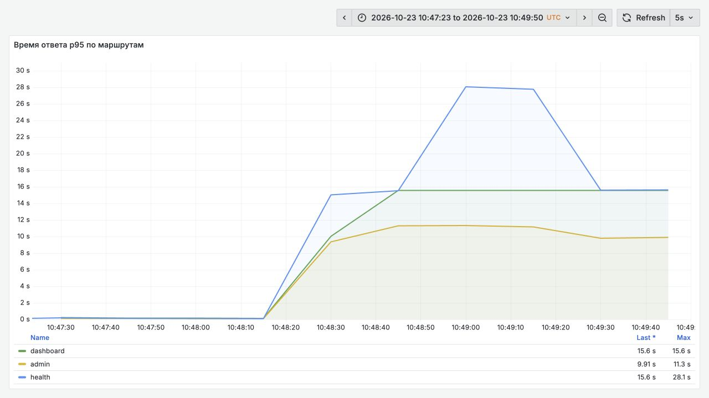

Рисунок 1. Grafana, опыт `baseline-slow`. Переход к медленному партнёру начинается около 10:48:11 UTC. На панели оценка p95 по гистограмме за 30 с, в таблице клиентские квантили.

В успешных секундных опросах метрик медианы составили 16 занятых потоков Tomcat, 6 активных соединений HikariCP и 10 ожидающих операций. Медиана `100 × process_cpu_usage` равнялась 2,5 %. Это нормированная загрузка процесса, которую Micrometer получает от JVM. Лимит контейнера задан отдельно, 2 CPU. Шесть из 72 опросов завершились ошибкой. На скриншотах действует независимый сбор Alloy раз в 5 с, поэтому его максимумы могут отличаться от секундной выборки.

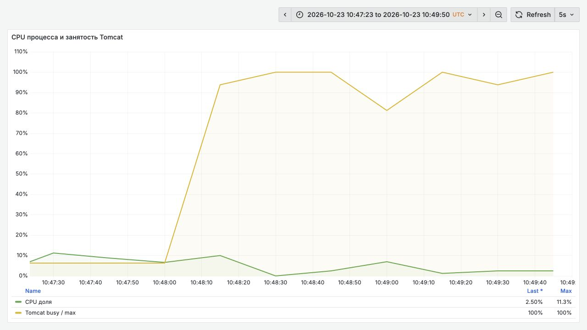

Рисунок 2. Исходный инцидент 23 октября. Все потоки Tomcat заняты при низкой загрузке CPU.

Дополнительная пара 29 октября использует одинаковые окна: 10 с прогрева и 60 с измерения. Версия `4575427`, лимиты, состав клиентов и интервал между началами запросов сохранены. Названия прогонов: `baseline-normal-symmetric` и `baseline-slow-pg`.

| Маршрут | Ответы 50 мс / 5000 мс | p95 при 50 мс, мс | p95 при 5000 мс, мс |
| --- | --- | --- | --- |
| Dashboard | 720 / 60 | 155,9 | 15033,5 |
| Admin | 60 / 7 | 52,5 | 10023,4 |
| Корневой health | 60 / 4 | 121,6 | 15034,1 |

Каждый из 71 ответа основной нагрузки медленной серии получил HTTP 200, в том числе все четыре ответа корневого health. Все 60 ответов dashboard содержали `partner.source=live`. Имя CPU-метрики подтверждено как `process_cpu_usage`, JVM экспортировала `system_cpu_count=2`. В этой серии удалось получить только 18 секундных опросов в измерительном окне, ещё 9 завершились ошибкой. По доступным точкам медиана Tomcat busy равна 15,5 при максимуме 16, Hikari active равна 6, pending равна 7,5 при максимуме 10. Число 2,5 % выше относится к первому опыту, а не переносится в новый.

[Паспорта и исходные данные новой пары](../evidence/baseline-slow-pg/passport.json) позволяют пересчитать ответы и квантили, включая запросы, завершившиеся после остановки новых поступлений.

В статье используются три основания для вывода. **Наблюдали**: есть результаты конкретного прогона с указанными условиями. **Следует из кода**: поведение подтверждается исходником указанного коммита. **Гипотеза**: объяснение требует отдельного опыта. Расчётные оценки подписаны отдельно от измерений. Для новых прогонов опубликованы паспорта и исходные данные. Исторические значения v4 сохранены по опубликованной статье, доступность их первичных файлов отдельно указана в приложении.

Если хочется сначала увидеть инцидент целиком, можно посмотреть [запись доклада JPoint](https://youtu.be/QJKoIuWu8JA). Здесь пойдём от занятого ресурса к конкретному месту в коде. Какой ресурс удерживает запрос, чего он ждёт и когда этот ресурс перейдёт к следующему запросу?

## 2. Арифметика инцидента

Шесть соединений и десять ожидающих дают те же шестнадцать, что и предел Tomcat. Это согласуется с картиной: часть потоков уже получила JDBC-соединение, остальные ждут своей очереди. Равенство медиан ещё не распределяет каждый поток по состояниям. Для этого ниже разберём дампы. Но уже сейчас понятно, почему свободный CPU ничего не говорит о возможности принять следующий запрос.

Оценим порядок пропускной способности. Если соединение удерживается около 5 с и пул содержит 6 соединений, его расчётный потолок для этого пути составляет `6 / 5 ≈ 1,2` операции в секунду. Это оценка по времени владения соединением, без дополнительных задержек SQL и планирования. Она объясняет, почему двенадцать клиентов не дают двенадцать завершений в секунду. В опыте за 90 с запуска начались 97 учтённых запросов dashboard, часть завершилась после окончания запуска. Деление 97 на 90 даёт 1,08, но для достигнутой пропускной способности нужен также завершающий интервал.

В новой симметричной серии `baseline-slow-pg` за измерительное окно начались 60 учтённых запросов dashboard. С завершением уже отправленной работы интервал составил около 70,2 с, достигнутая пропускная способность этого потока равна примерно 0,85 запроса в секунду. Это результат совместной нагрузки, включая конкуренцию со служебными проверками. Расчётные 1,2 операции в секунду описывают только идеализированную границу JDBC и не являются обещанием результата всего приложения.

Четырнадцать основных клиентов тоже не задают предел в четырнадцать запросов к Tomcat. Одновременно приходят опросы Prometheus (`scrape`), а также отдельные readiness- и liveness-пробы. Они используют тот же HTTP-коннектор. Во время перегрузки эти запросы могут перекрываться с основной нагрузкой и друг с другом.

Почему health способен ждать дольше dashboard? Корневой `/actuator/health` сначала должен получить поток Tomcat, затем выполняет проверки компонентов. Среди них есть стандартный `db`: ему нужно JDBC-соединение, а ожидание Hikari ограничено `connectionTimeout = 12 с`. Такой путь допускает последовательное ожидание двух ресурсов. Это объяснение следует из кода и состава health. Отдельные интервалы внутри тех шести запросов v4 не измерялись.

Общую связь описывает закон Литтла: `L = λ × W`. Здесь `L` означает среднее число незавершённых операций внутри выбранной границы, `λ` обозначает среднюю интенсивность завершения, `W` соответствует среднему времени внутри той же границы. Для потока через Hikari учитываем время владения соединением, для внешнего HTTP другую границу. Подставлять клиентский p95 вместо среднего `W` нельзя. При устойчивой нагрузке формула помогает проверить порядок величин, а предел `m / S` помогает оценить пропускную способность ресурса с `m` местами и временем обслуживания `S`.

Какие именно запросы конкурируют за эти шестнадцать потоков и шесть соединений?

## 3. Три маршрута и общие ресурсы

Тяжёлый `GET /api/v1/dashboard/{id}` читает данные из PostgreSQL, вызывает внешний API и собирает ответ. `GET /api/v1/admin/status` получает служебную информацию из БД. Actuator предоставляет health-проверки и метрики. Это разные функции одного приложения, которым нужны общие потоки Tomcat и соединения HikariCP.

Лёгкий запрос способен ждать дольше тяжёлого: для короткого SQL ему сначала должно достаться соединение. Проверка без SQL тоже может задержаться до начала своего кода, если все рабочие потоки заняты. Поэтому деление маршрутов на «тяжёлые» и «служебные» ещё не задаёт изоляцию ресурсов.

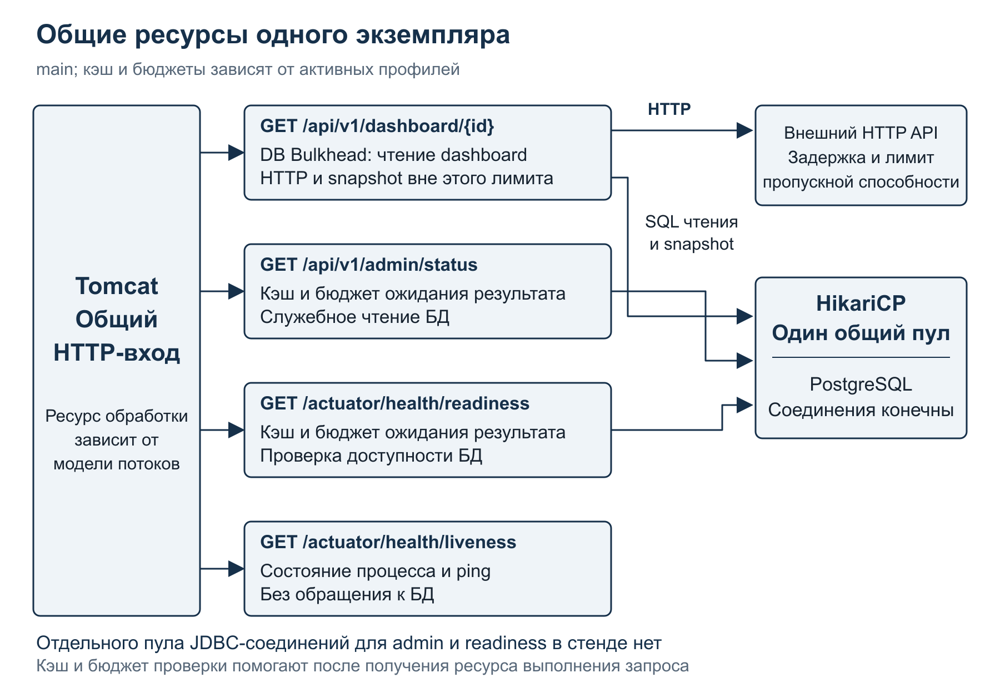

Рисунок 3. Общие ресурсы одного экземпляра. Кэширование проверок и ограничение времени ожидания сами по себе не создают отдельного HTTP-коннектора или отдельного JDBC-пула.

В исходном приложении SQL и последующий HTTP-вызов находятся в одной транзакции. После чтения данные уже лежат в памяти, но JDBC-соединение возвращается только при завершении внешнего транзакционного метода. Задержка партнёра начинает расходовать ресурс PostgreSQL. Пока ограничимся этой последовательностью, затем проверим её с двух сторон: по стеку JVM и по состоянию соединений в самой БД.

Сигналы собираются через Actuator. Alloy передаёт метрики в Mimir, логи в Loki, трассировки в Tempo, а Grafana показывает их вместе. При расследовании каждый сигнал должен отвечать на конкретный вопрос. Клиентская задержка показывает ущерб, занятость пула показывает предел, стек объясняет, что сейчас делает владелец ресурса.

Что искать на этих панелях, чтобы выбрать следующий диагностический шаг?

## 4. Три очереди и дампы потоков

«Три очереди» здесь обозначают диагностическую модель. Tomcat, HikariCP и внешний API показывают разные формы незавершённой работы. В Tomcat сравниваем занятые рабочие потоки с `maxThreads`. `maxConnections` ограничивает соединения, `acceptCount` относится к очереди приёма. Эти величины описывают разные пределы.

У HikariCP нужны `active`, `idle`, `max`, `pending` и ошибки получения соединений. Полный пул с `pending > 0` показывает конкуренцию за соединение. Причину ищем у владельцев: долгий SQL, блокировка в БД, широкая транзакция или внешнее ожидание внутри неё. Для партнёра нужны задержка, число выполняющихся запросов (`in-flight`), ошибки и отказы защит. Между этими границами может оказаться ещё очередь исполнителя задач, до которой HTTP-счётчик пока не дошёл.

RED объединяет интенсивность запросов, ошибки и длительность. USE добавляет загрузку, насыщение и ошибки ресурса. Сведите сигналы на одну шкалу: изменение задержки партнёра, Tomcat busy, Hikari pending и клиентскую задержку. Без общей шкалы корреляцию легко принять за причинность. Отдельно смотрите незавершённые запросы: их длительность ещё не попала в статистику завершений.

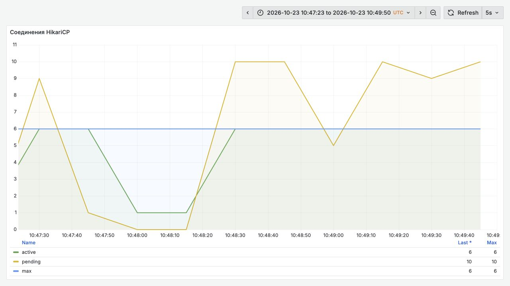

Рисунок 4. Исходный инцидент 23 октября. Все шесть соединений заняты, `pending` достигает десяти. Чтобы найти причину удержания, переходим к дампам потоков.

Дамп связывает график с выполняющимся кодом. Его лучше получать несколько раз с небольшим интервалом, пока проблема воспроизводится. Состояние JVM читаем вместе со стеком. `RUNNABLE` может соответствовать нативному чтению сокета. `TIMED_WAITING` бывает ожиданием с тайм-аутом или искусственным `Thread.sleep`. Состояние `BLOCKED` связано с входом в Java-монитор, тогда как ожидание блокировки PostgreSQL в Java способно выглядеть как сетевое чтение.

Ниже два фрагмента, опубликованные 23 октября для `baseline-slow`, JDK `25.0.3+9-LTS`. Они получены через `jcmd 9 Thread.print -l`, где 9 был PID JVM именно того контейнера. В другом запуске PID определяем заново. Строки `[editorial omission]` обозначают пропуски между выбранными кадрами, остальные кадры сохранены дословно.

Первый дамп имеет время **2026-10-23 10:49:11 UTC**. Поток читает ответ внешнего API.

```text
"http-nio-8080-exec-2" ...
   java.lang.Thread.State: RUNNABLE
    at sun.nio.ch.Net.poll(java.base@25.0.3/Native Method)
    at sun.nio.ch.NioSocketImpl.park(java.base@25.0.3/NioSocketImpl.java:190)
    at sun.nio.ch.NioSocketImpl.timedRead(java.base@25.0.3/NioSocketImpl.java:279)
... [editorial omission]
    at sun.net.www.protocol.http.HttpURLConnection.getInputStream0(java.base@25.0.3/HttpURLConnection.java:1392)
... [editorial omission]
    at net.proselyte.demo.hanganatomy.client.PartnerClient.invokePartnerApi(PartnerClient.java:162)
... [editorial omission]
    at net.proselyte.demo.hanganatomy.service.DashboardService.getDashboard(DashboardService.java:42)
... [editorial omission]
    at org.springframework.transaction.interceptor.TransactionAspectSupport.invokeWithinTransaction(TransactionAspectSupport.java:371)
```

Верхушка стека показывает чтение сокета, ниже находятся `PartnerClient`, сборка dashboard и транзакционный перехватчик. Метка `RUNNABLE` здесь не доказывает загрузку CPU. Значения `cpu` и `elapsed` из заголовка потока, если они присутствуют в полном дампе, относятся к жизни потока, а не к одному запросу.

Второй дамп снят в **2026-10-23 10:49:25 UTC**. Другой рабочий поток ещё пытается получить соединение.

```text
"http-nio-8080-exec-1" ...
   java.lang.Thread.State: TIMED_WAITING (parking)
    at jdk.internal.misc.Unsafe.park(java.base@25.0.3/Native Method)
    - parking to wait for  <0x00000000d47abe78> (a java.util.concurrent.SynchronousQueue$Transferer)
    at java.util.concurrent.locks.LockSupport.parkNanos(java.base@25.0.3/LockSupport.java:408)
    at java.util.concurrent.LinkedTransferQueue$DualNode.await(java.base@25.0.3/LinkedTransferQueue.java:452)
    at java.util.concurrent.LinkedTransferQueue.xfer(java.base@25.0.3/LinkedTransferQueue.java:613)
    at java.util.concurrent.SynchronousQueue.xfer(java.base@25.0.3/SynchronousQueue.java:235)
    at java.util.concurrent.SynchronousQueue.poll(java.base@25.0.3/SynchronousQueue.java:338)
    at com.zaxxer.hikari.util.ConcurrentBag.borrow(ConcurrentBag.java:163)
    at com.zaxxer.hikari.pool.HikariPool.getConnection(HikariPool.java:160)
    at com.zaxxer.hikari.pool.HikariPool.getConnection(HikariPool.java:142)
    at com.zaxxer.hikari.HikariDataSource.getConnection(HikariDataSource.java:127)
    at org.springframework.jdbc.datasource.DataSourceTransactionManager.doBegin(DataSourceTransactionManager.java:270)
    at org.springframework.transaction.support.AbstractPlatformTransactionManager.startTransaction(AbstractPlatformTransactionManager.java:532)
```

`ConcurrentBag.borrow` и `HikariPool.getConnection` локализуют ожидание внутри пула. `DataSourceTransactionManager.doBegin` показывает начало транзакции. Это иной случай, чем уже выполняющийся долгий SQL. За 14 с между дампами на рабочих потоках могли смениться запросы, поэтому читаем их как два состояния одного инцидента.

Метрики показывают масштаб ожидания, дампы дают его адрес в коде. Почему же соединение остаётся занятым, пока поток читает HTTP?

## 5. Транзакция и время владения соединением

В исходной версии транзакция охватывает весь метод сборки ответа. Сначала выполняются JDBC-запросы dashboard и его элементов, потом вызывается партнёр. Вот метод целиком из `4575427`.

```java
    @Transactional(readOnly = true)
    public DashboardResponse getDashboard(UUID id) {
        DemoMode mode = demoModeRegistry.currentMode();
        DashboardData dashboardData = dashboardReadService.loadDashboardData(id, mode);
        PartnerCallResult partnerCallResult = partnerClient.loadPartnerData(
                id,
                mode,
                RequestDeadline.after(properties.partner().overallDeadline())
        );
        return dashboardResponseMapper.toResponse(dashboardData, partnerCallResult, mode);
    }
```

[DashboardService.java, строки с 38 по 48](https://github.com/proselytear/jug-hang-anatomy/blob/457542776c916e55fefe63fddd8ce88dbd6a3b9a/src/main/java/net/proselyte/demo/hanganatomy/service/DashboardService.java#L38-L48).

Внутренний `DashboardReadService` тоже помечен `@Transactional(readOnly = true)`, но участвует в уже открытой транзакции. Его возврат не завершает внешнюю границу. Соединение уже получено для SQL и остаётся у запроса до выхода из `getDashboard`. Поэтому время внешнего HTTP прибавляется ко времени владения JDBC-соединением.

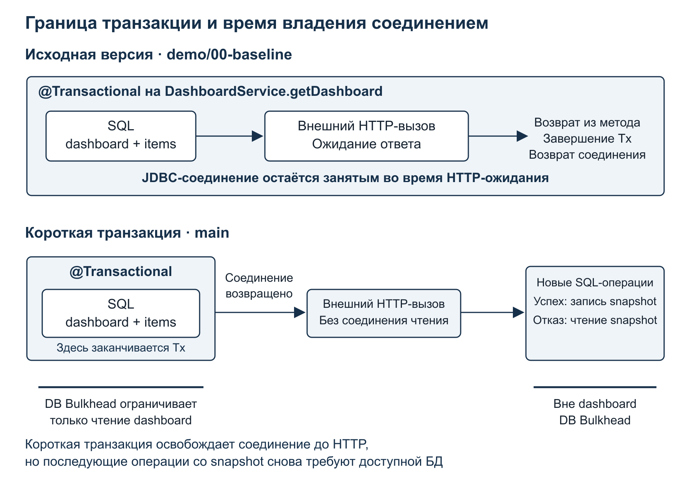

Рисунок 8. В исходной версии HTTP продлевает транзакцию чтения. В коротком варианте соединение возвращается до обращения к партнёру. Работа со снимками данных выполняется отдельно.

Дополнительный опыт `baseline-slow-pg` даёт независимое свидетельство со стороны PostgreSQL. В снимке **2026-10-29 20:22:51 UTC** пять соединений находятся в `idle in transaction` и ждут клиента (`ClientRead`). Возраст транзакций около 4 с, последняя команда читала `dashboard_item`. Шестое соединение в этом снимке имеет состояние `idle`. Ниже четыре последовательные строки одного соединения из полного вывода. Колонки: PID, состояние, тип и событие ожидания, возраст транзакции и запроса, последний SQL.

```text
 307 | idle in transaction | Client          | ClientRead | 00:00:03.987392 | 00:00:03.985207 | select id, dashboard_id, metric_name, metric_value, created_at+
     |                     |                 |            |                 |                 | from dashboard_item                                           +
     |                     |                 |            |                 |                 | where dashboard_id = $1                                       +
     |                     |                 |            |                 |                 | order by created_at                                           +
```

[Полный вывод pg_stat_activity](../evidence/baseline-slow-pg/pg_stat_activity-1.txt). PostgreSQL уже закончил этот SELECT и ждёт следующей команды клиента. В сочетании с JVM-стеком HTTP-чтения и внешней транзакционной границей это подтверждает, почему занятое соединение не возвращается в пул во время ожидания партнёра.

После сокращения транзакции внешний метод уже не содержит `@Transactional`. Чтение остаётся в отдельном Spring-сервисе и проходит через транзакционную обёртку. Метод чтения в `8c14914` выглядит так.

```java
    @Transactional(readOnly = true)
    public DashboardData loadDashboardData(UUID id, DemoMode mode) {
        DashboardRecord dashboard = dashboardRepository.findByIdRequired(id);
        List<DashboardItemRecord> items = dashboardItemRepository.findByDashboardId(id);
        maybeSimulateDbDelay(mode);
        return new DashboardData(dashboard, items);
    }
```

[DashboardReadService.java, строки с 33 по 39](https://github.com/proselytear/jug-hang-anatomy/blob/8c14914cb6b5533614cfae6e1035fe61c5a4c1de/src/main/java/net/proselyte/demo/hanganatomy/service/DashboardReadService.java#L33-L39).

Репозитории возвращают обычные записи с уже прочитанными полями. Партнёрскому HTTP-вызову открытая транзакция для доступа к этим данным не нужна. После возврата метода чтения завершается транзакция и освобождается её соединение. Вызов `maybeSimulateDbDelay` оставлен дословно: в некоторых режимах он добавляет ожидание после SQL внутри транзакции. В сравнении исходной и короткой версий эта искусственная задержка выключена.

В опубликованном опыте `short-slow` защиты выключены, лимиты сохранены: Tomcat 16, Hikari 6, партнёр отвечает через 5 с. За 60 с получены **144 ответа со свежими данными**, p95 5067,6 мс. Admin и health дали по 60 ответов, их p95 составил 13,4 и 14,5 мс. Во всех 60 точках опроса Hikari `pending` равен нулю. Сравнение включает и новую обработку служебных запросов в `main`, поэтому весь эффект для health не приписываем одной удалённой аннотации.

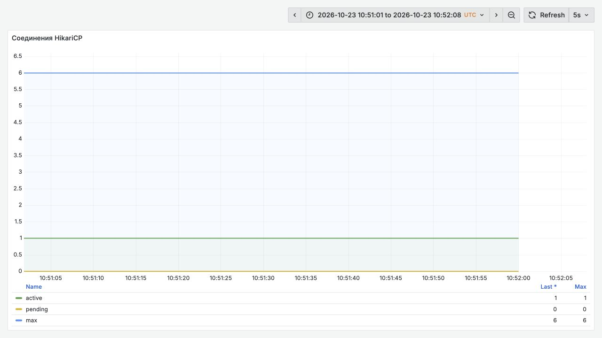

Рисунок 5. Опыт `short-slow`: очередь за JDBC-соединениями отсутствует на полученных точках, HTTP-ожидание продолжается.

### Проверяем DB Bulkhead отдельно

Когда само чтение долго удерживает соединение, нужна другая защита. В `DashboardService` semaphore Bulkhead оборачивает `dashboardReadService.loadDashboardData`. Если разрешения закончились, код увеличивает счётчик и выбрасывает `HeavyRequestRejectedException`. Обработчик возвращает HTTP 429. Отказ происходит до нового тяжёлого чтения. [Граница DB Bulkhead в 8c14914](https://github.com/proselytear/jug-hang-anatomy/blob/8c14914cb6b5533614cfae6e1035fe61c5a4c1de/src/main/java/net/proselyte/demo/hanganatomy/service/DashboardService.java#L73-L85).

Для проверки 23 октября использован режим `tx-hold`: партнёр быстрый, после SQL внутри транзакции добавляются 1500 мс ожидания. Hikari содержит десять соединений. Это модель долгого владения соединением, а не замер времени SQL.

| Условия опыта v4 | Свежие ответы dashboard | p95 свежих ответов, мс | Отказы dashboard | Корневой health |
| --- | --- | --- | --- | --- |
| `tx-hold`, DB Bulkhead выключен | 264 | 2311,8 | 0 | 29 из 40 ответов HTTP 503 |
| `tx-hold-guard`, DB Bulkhead 6 | 150 | 1570,2 | 240 ответов HTTP 429 | Все 40 ответов HTTP 200 |

Без ограничителя заняты около десяти соединений, `pending` достигает трёх. При шести разрешениях DB Bulkhead очередь на полученных точках исчезает. Все 40 admin и 40 health отвечают HTTP 200, p95 составляет 15,7 и 18,2 мс. Цена видна в таблице: 240 тяжёлых запросов отклонены.

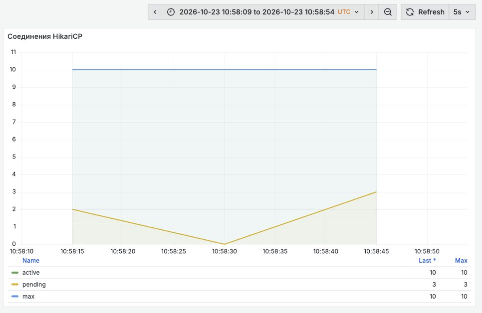

Рисунок 9. Опыт `tx-hold`: искусственное ожидание внутри транзакции занимает весь HikariCP.

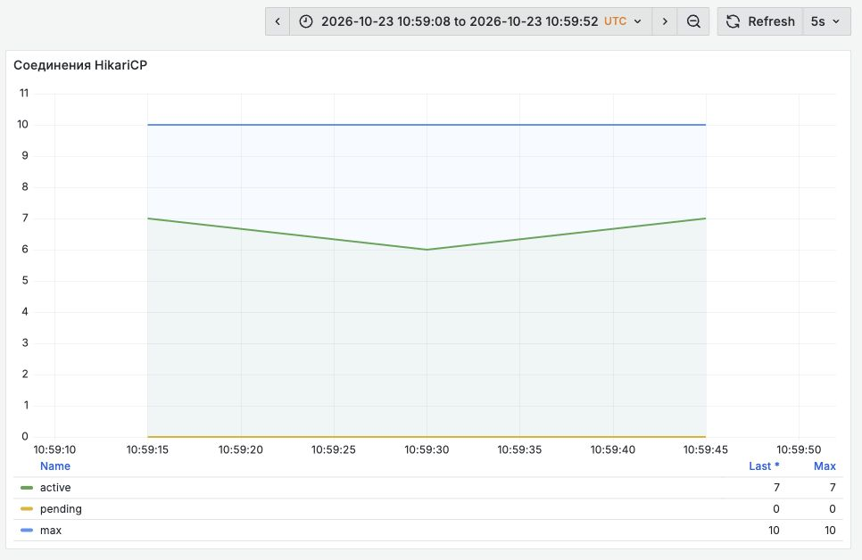

Рисунок 10. Опыт `tx-hold-guard`: шесть разрешений при Hikari 10 уменьшают конкуренцию за соединения.

`DB Bulkhead` защищает только чтение dashboard. Admin, readiness и операции со снимками данных используют тот же HikariCP вне этого ограничителя. Поэтому десять соединений и шесть разрешений ограничителя не являются отдельным пулом из четырёх соединений для admin. В штатном профиле `demo-latency` различие ещё заметнее: Hikari содержит шесть соединений, а DB Bulkhead допускает десять чтений. Настройки имеют смысл только вместе с профилем запуска.

Соединения уже возвращаются до HTTP, но партнёр всё ещё отвечает через 5 с. Как ограничить расход потоков на это ожидание?

## 6. Ограничиваем параллельность внешних вызовов

На том же `8c14914` включаем только partner Bulkhead с восемью разрешениями. TimeLimiter, Circuit Breaker, DB Bulkhead и Rate Limiter выключены. Нагрузка, лимиты и задержка партнёра остаются прежними, снимок данных заранее существует. Это опыт `bulkhead-slow`.

Bulkhead задаёт предел одновременных вызовов. При `maxWaitDuration = 0` лишняя работа отклоняется сразу, вместо ожидания разрешения. В сервисе такую ситуацию обрабатывает резервный путь: он читает последний снимок данных из PostgreSQL и явно сообщает его источник клиенту. Метафора водонепроницаемых отсеков здесь уместна: ограничивается участок работы, на котором одна зависимость может занять все общие ресурсы.

Из 336 тяжёлых ответов **96 содержат свежие данные, 240 используют снимок** с `outcome=fallback-bulkhead`. У свежих ответов p95 5021,8 мс, у резервных 12,2 мс. Все ответы имеют HTTP 200. На полученных точках одновременно выполняются восемь HTTP-вызовов, свободных разрешений нет.

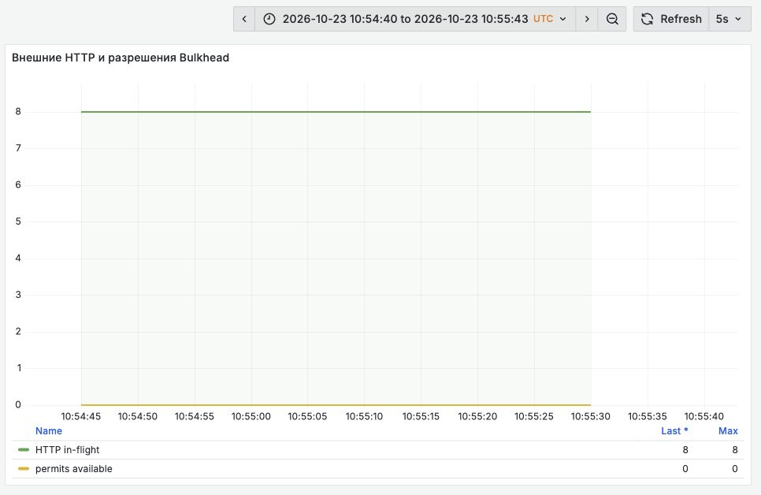

Рисунок 6. Опыт `bulkhead-slow`. Ограничитель допускает восемь обращений к партнёру. Резервное чтение из PostgreSQL выполняется за его пределами.

Внешний API быстрее не стал: свежий ответ по-прежнему занимает около пяти секунд. Изменились допуск и результат для остальных запросов. У общего распределения задержек растёт доля быстрых резервных ответов, поэтому общий p95 нельзя читать как время получения свежих данных.

Быстрый ответ со снимком возвращает управление клиенту. Но сколько времени мы готовы ждать свежие данные и что происходит с работой после тайм-аута?

## 7. Бюджет времени и тайм-аут

До обращения к партнёру запрос уже мог ждать соединение и читать данные. Если на следующем этапе выдать ему полный тайм-аут заново, общее ожидание окажется больше, чем рассчитывал клиент нашего сервиса. В `DashboardService` общий бюджет времени создаётся до чтения БД:

```java
    public DashboardResponse getDashboard(UUID id) {
        DemoMode mode = demoModeRegistry.currentMode();
        RequestDeadline deadline = RequestDeadline.after(properties.partner().overallDeadline());
        guardRateLimit(mode);
        DashboardData dashboardData = guardedDashboardRead(id, mode);
        PartnerCallResult partnerCallResult = partnerClient.loadPartnerData(id, mode, deadline);
        return dashboardResponseMapper.toResponse(dashboardData, partnerCallResult, mode);
    }
```

[DashboardService.java, строки с 53 по 60](https://github.com/proselytear/jug-hang-anatomy/blob/8c14914cb6b5533614cfae6e1035fe61c5a4c1de/src/main/java/net/proselyte/demo/hanganatomy/service/DashboardService.java#L53-L60), коммит `8c14914`.

Перед вызовом партнёра `RequestDeadline.budget` выбирает меньшее из оставшегося времени и прикладного тайм-аута:

```java
    public Duration budget(Duration preferred) {
        Duration remaining = remaining();
        if (remaining.isZero()) {
            return Duration.ZERO;
        }
        return remaining.compareTo(preferred) < 0 ? remaining : preferred;
    }
```

[RequestDeadline.java, строки с 19 по 25](https://github.com/proselytear/jug-hang-anatomy/blob/8c14914cb6b5533614cfae6e1035fe61c5a4c1de/src/main/java/net/proselyte/demo/hanganatomy/service/RequestDeadline.java#L19-L25). Если бюджет исчерпан, `PartnerClient` сразу переходит к сохранённым данным. Иначе рассчитанное время получает `TimeLimiter`, если он включён.

Здесь `overall-deadline` ограничивает бюджет обращения к партнёру. Чтение dashboard, чтение снимка данных и его сохранение после успешного HTTP не прерываются этим бюджетом. Поэтому значение `2s` в базовой конфигурации не задаёт верхнюю границу длительности всего запроса. Профиль `demo-latency` дополнительно меняет это значение на `15s`.

У разных тайм-аутов разные границы действия:

| Ограничение | На каком этапе действует | Что остаётся за его пределами |
| --- | --- | --- |
| Hikari `connectionTimeout` | Выдача соединения из пула | Выполнение SQL после выдачи соединения |
| JDBC `connectTimeout` | Установление соединения с БД | Дальнейшее выполнение и блокировки SQL |
| SQL или `statement timeout` | Выполнение операции на соответствующем слое | Остальные этапы бизнес-операции |
| HTTP `connect timeout` | Установление соединения | Получение ответа |
| HTTP `read timeout` | Ожидание чтения по правилам HTTP-клиента | Сквозной бюджет запроса |
| `TimeLimiter` | Ожидание результата на выбранном API-пути | Фактическое завершение уже начатого ввода-вывода |

В стенде используется `SimpleClientHttpRequestFactory`. Отдельного управляемого пула Apache HTTP Client здесь нет. Тайм-аут ожидания соединения из такого пула был бы ещё одним слоем защиты в другой реализации. Аналогично ограничение ожидания Hikari не подменяет [сетевые параметры PostgreSQL JDBC](https://jdbc.postgresql.org/documentation/use/) и ограничения выполнения SQL.

### Почему ответ уже вернулся, а работа продолжается

Для обращения к партнёру создаётся `TimeLimiter` с рассчитанным бюджетом:

```java
        TimeLimiter timeLimiter = TimeLimiter.of(TimeLimiterConfig.custom()
                .timeoutDuration(budget)
                .cancelRunningFuture(true)
                .build());
```

[PartnerClient.java, строки с 110 по 113](https://github.com/proselytear/jug-hang-anatomy/blob/8c14914cb6b5533614cfae6e1035fe61c5a4c1de/src/main/java/net/proselyte/demo/hanganatomy/client/PartnerClient.java#L110-L113).

Задача выполняется в `partnerExecutor`, а поток запроса ждёт `completionStage.toCompletableFuture().get()`. До завершения этого ожидания поток Tomcat остаётся занят. [PartnerClient.java, строки с 104 по 120](https://github.com/proselytear/jug-hang-anatomy/blob/8c14914cb6b5533614cfae6e1035fe61c5a4c1de/src/main/java/net/proselyte/demo/hanganatomy/client/PartnerClient.java#L104-L120).

В Resilience4j 2.4.0 путь `decorateCompletionStage` по истечении времени вызывает `completeExceptionally`. Флаг `cancelRunningFuture` на этом пути не читается. Вызов `future.cancel(true)` есть в другом API, `decorateFutureSupplier`. Это видно в [TimeLimiterImpl версии 2.4.0](https://github.com/resilience4j/resilience4j/blob/v2.4.0/resilience4j-timelimiter/src/main/java/io/github/resilience4j/timelimiter/internal/TimeLimiterImpl.java#L37-L101).

Есть и отдельное ограничение самого `CompletableFuture`: в его [документации JDK 25](https://docs.oracle.com/en/java/javase/25/docs/api/java.base/java/util/concurrent/CompletableFuture.html#cancel(boolean)) параметр `mayInterruptIfRunning` не влияет на обработку. Отмена такого объекта сама по себе не отправляет прерывание потоку, исполняющему задачу. Флаг в конфигурации, завершение ожидания и прекращение сетевой операции относятся к разным действиям.

Проверим это на прогоне `timeout-tail` 23 октября. Прикладной тайм-аут равен 1 с, общий бюджет времени 3 с, сетевой тайм-аут чтения 8 с. Партнёр отвечает через 5 с. Circuit Breaker и Rate Limiter выключены. Одновременно отправлены восемь тяжёлых запросов, следующей серии нет. Все восемь получили HTTP 200 со снимком данных и `outcome=fallback-timeout` за время от 1041 до 1082 мс.

Последний клиентский ответ завершился в **10:57:07.614 UTC**. В **10:57:11.554 UTC** опрос всё ещё показывал восемь выполняющихся HTTP-вызовов и ноль свободных разрешений партнёрского Bulkhead. В **10:57:12.557 UTC** впервые наблюдались ноль вызовов и восемь свободных разрешений. Значит, ресурсы оставались заняты ещё от 4 до 5 с после последнего ответа. Точный момент освобождения находится между двумя опросами.

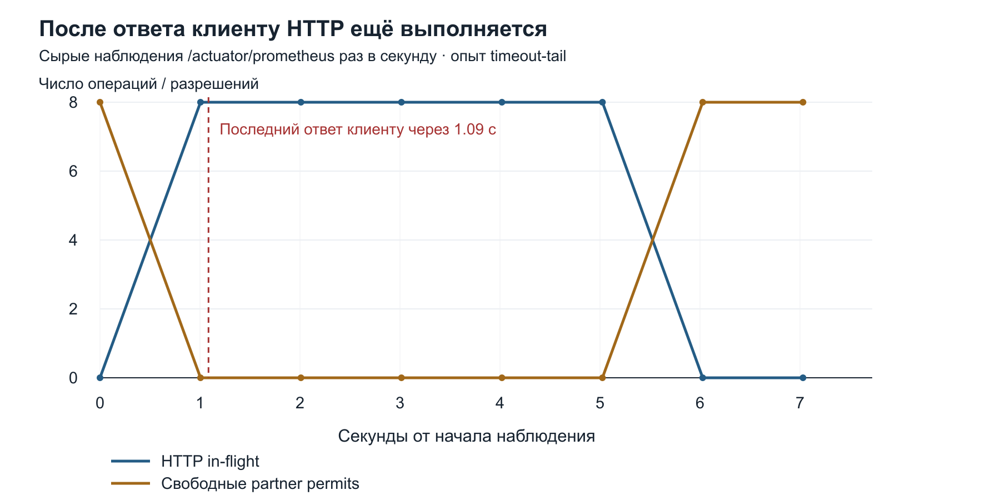

Рисунок 12. Секундные наблюдения прогона `timeout-tail`. Клиент уже получил резервный ответ, но начатые обращения к партнёру ещё занимают ресурсы. Полная заданная задержка партнёра равна 5 с, наблюдаемый хвост после ответа составляет от 4 до 5 с.

Дополнительный опыт `timeout-tail-confirm` 29 октября проверяет и поздний результат. Настройки сохранены: TimeLimiter 1 с, бюджет 3 с, HTTP read timeout 8 с, восемь разрешений Bulkhead, партнёр 5 с. Circuit Breaker теперь включён, чтобы увидеть его счётчики. Все восемь клиентов получили `fallback-timeout` за 1078,2-1079,7 мс. Последний ответ завершился в **20:29:08.905 UTC**. Дамп начат в **20:29:10.907 UTC**, через 2,002 с: все восемь `partner-exec-*` ещё находились в сетевом чтении.

Последний опрос с восемью занятыми вызовами завершился в **20:29:12.834 UTC**, первый со свободными ресурсами в **20:29:13.832 UTC**. После последнего ответа клиента работа продолжалась между 3,929 и 4,927 с. Счётчик Circuit Breaker `successful` вырос с 0 до 8, `failed` остался нулевым, а число медленных успешных вызовов выросло с 0 до 8. Число записей снимков данных осталось 660. Так подтверждён поздний успешный HTTP, результат которого не дошёл до обычного сохранения снимка. [Дамп через две секунды после ответа](../evidence/timeout-tail-confirm/threads-after-last-response-2s.txt) и [приращения счётчиков](../evidence/timeout-tail-confirm/analysis.json) опубликованы вместе с паспортом.

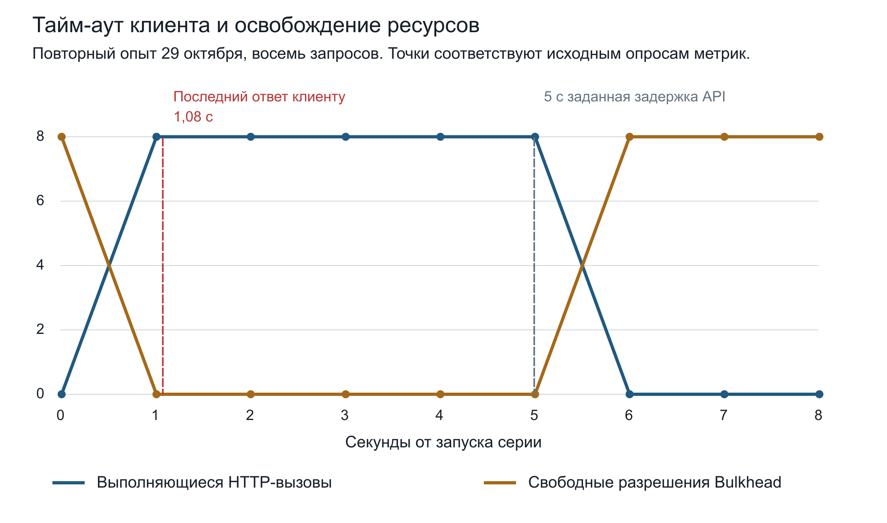

Рисунок 17. Новый опыт `timeout-tail-confirm`, исходные секундные опросы 29 октября. Красная линия отмечает последний клиентский ответ. Серая линия задаёт справочные 5 с от запуска серии, соответствующие настроенной задержке партнёра. Это не измерение начала каждого HTTP-вызова. Точное освобождение ресурса лежит между последней занятой и первой свободной точкой.

Результат согласуется с порядком вызовов в коде. Если начатый HTTP завершается успешно после срабатывания `TimeLimiter`, обёртка Circuit Breaker внутри задачи видит этот успех и его полную длительность. Вызывающий поток уже перешёл в `fallbackOrThrow`, поэтому результат не попадает в обычный путь `persistSnapshotBestEffort`. Сам график показывает время владения ресурсами, но не HTTP-статус позднего ответа.

### Очередь перед обращением к партнёру

`partnerExecutor` создан так:

```java
    @Bean(destroyMethod = "shutdown")
    ExecutorService partnerExecutor() {
        return Executors.newFixedThreadPool(16, Thread.ofPlatform().name("partner-exec-", 0).factory());
    }
```

[RestClientConfig.java, строки с 35 по 38](https://github.com/proselytear/jug-hang-anatomy/blob/8c14914cb6b5533614cfae6e1035fe61c5a4c1de/src/main/java/net/proselyte/demo/hanganatomy/config/RestClientConfig.java#L35-L38), коммит `8c14914`.

Шестнадцать здесь ограничивает рабочие потоки. `newFixedThreadPool` использует [очередь без заданного предела ёмкости](https://docs.oracle.com/en/java/javase/25/docs/api/java.base/java/util/concurrent/Executors.html#newFixedThreadPool(int)). Задача попадает в неё до проверки декораторов. Пока она ждёт, счётчик HTTP-вызовов партнёра её ещё не учитывает.

Число потоков Tomcat тоже не даёт постоянного ограничения этой очереди. После тайм-аута запрос заканчивается, а ранее отправленная задача может оставаться в очереди или продолжать работу. Освободившийся поток принимает следующий запрос и способен отправить ещё одну задачу. Даже при платформенных потоках из кода не следует граница `maxThreads - 16`. При виртуальных потоках исчезает и прежний предел одновременно ожидающих входящих HTTP-запросов.

При этом в описанных опытах нет доказательства, что очередь `partnerExecutor` стала главным ограничением. В основной конфигурации HTTP защищён восемью разрешениями Bulkhead при шестнадцати рабочих потоках исполнителя. Для отдельного расследования нужны длина очереди, занятые потоки и время ожидания задачи. В сопроводительном [изменении RestClientConfig](https://github.com/proselytear/jug-hang-anatomy/blob/29c24af/src/main/java/net/proselyte/demo/hanganatomy/config/RestClientConfig.java#L37-L51) добавлена регистрация `partnerExecutor` и `budgetExecutor` через `ExecutorServiceMetrics`. Для новой версии доступны `executor_queued_tasks{name="partner-executor"}` и `executor_active_threads{name="partner-executor"}`. Эти метрики относятся к новому коду, историческим прогонам их значения не приписываем.

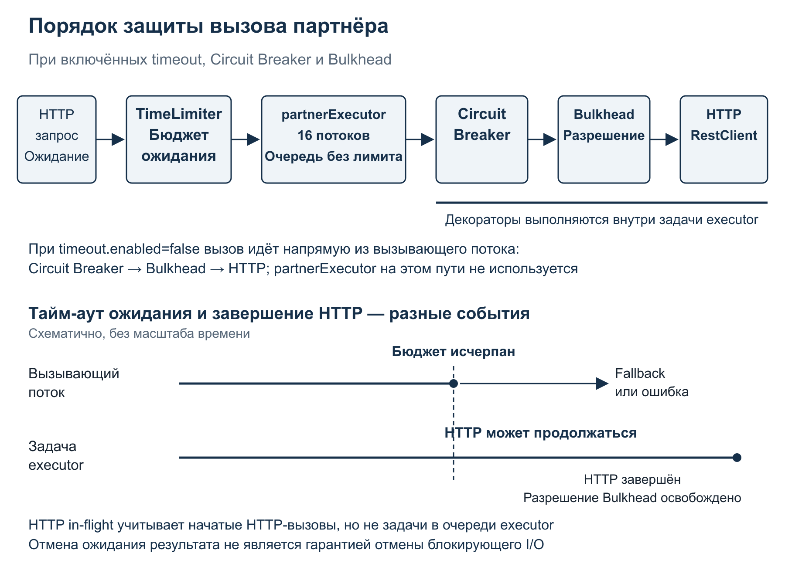

Рисунок 11. Очередь `partnerExecutor` находится перед проверкой защит. При тайм-ауте ожидание потока запроса заканчивается раньше работы задачи, поэтому лимит Tomcat сам по себе не ограничивает накопление задач.

Мы ограничили ожидание клиента и увидели, какая работа переживает его ответ. Как теперь отличить перегрузку своего приложения от отказа партнёра?

## 8. Circuit Breaker и Rate Limiter при выборе резервного ответа

Bulkhead ограничивает число одновременных операций. Circuit Breaker использует историю результатов, чтобы разрешить или запретить следующую попытку. Rate Limiter ограничивает темп допуска. Их взаимодействие определяется местом проверки и тем, какие события попадают в статистику.

В `PartnerClient` порядок обёрток задан явно:

```java
    private Callable<PartnerPayload> decorate(Callable<PartnerPayload> function) {
        Callable<PartnerPayload> guarded = function;
        if (properties.partner().bulkhead().enabled()) {
            guarded = Bulkhead.decorateCallable(partnerBulkhead, guarded);
        }
        if (properties.partner().circuitBreaker().enabled()) {
            guarded = CircuitBreaker.decorateCallable(partnerCircuitBreaker, guarded);
        }
        return guarded;
    }
```

[PartnerClient.java, строки с 142 по 151](https://github.com/proselytear/jug-hang-anatomy/blob/8c14914cb6b5533614cfae6e1035fe61c5a4c1de/src/main/java/net/proselyte/demo/hanganatomy/client/PartnerClient.java#L142-L151), коммит `8c14914`.

Сначала выполняется внешняя обёртка Circuit Breaker, затем Bulkhead, затем HTTP. Если Bulkhead отказывает, исключение проходит через Circuit Breaker. В конфигурации стенда `BulkheadFullException` не исключено из учёта. По [правилам CircuitBreakerConfig 2.4.0](https://github.com/resilience4j/resilience4j/blob/v2.4.0/resilience4j-circuitbreaker/src/main/java/io/github/resilience4j/circuitbreaker/CircuitBreakerConfig.java#L52-L71) такой результат учитывается как ошибка.

В базовой конфигурации окно автомата содержит 20 вызовов, расчёт начинается после 10 результатов. Пороги ошибок и медленных вызовов равны 50 %. Медленным считается вызов дольше 900 мс. Поэтому партнёр может успешно вернуть HTTP 200 и всё же внести вклад в открытие Circuit Breaker. Тайм-аут, который уже увидел клиент нашего сервиса, также не обязан совпасть по времени с результатом внутри автомата.

### Быстрый партнёр и открытый Circuit Breaker

В прогоне `cb-local-normal` партнёр отвечает за 50 мс, у Bulkhead два разрешения, граница медленного вызова поднята до 10 с. `TimeLimiter` и Rate Limiter выключены. Так отделяем локальные отказы допуска от медленных ответов внешнего API.

За 30 с получены 360 тяжёлых результатов:

| Результат | Количество |
| --- | --- |
| Свежие данные партнёра `live` | 10 |
| Снимок данных с `fallback-bulkhead` | 30 |
| Снимок данных с `fallback-circuit-open` | 316 |
| HTTP 429 от DB Bulkhead | 4 |

На 27 из 30 секундных опросов Circuit Breaker находился в `open`. Вместе с порядком обёрток этот опыт показывает конкретную ошибку интерпретации: локальные отказы приложения попадают в статистику здоровья партнёра.

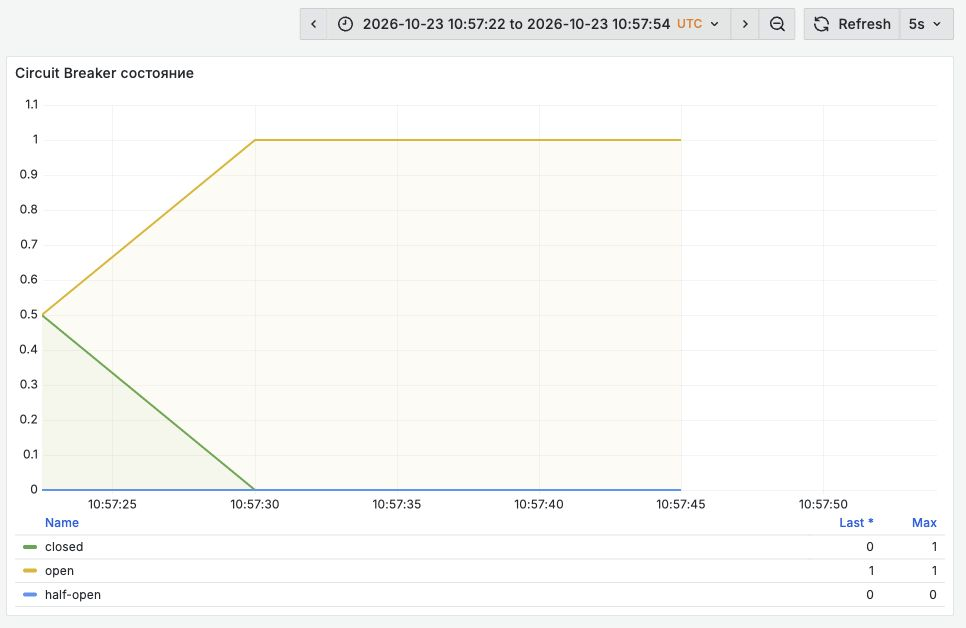

Рисунок 13. Прогон `cb-local-normal`: партнёр отвечает быстро, но Circuit Breaker открывается при двух разрешениях Bulkhead.

При переносе этого решения в рабочую систему нужно определить, какие исключения описывают недоступность партнёра. Ошибка собственного допуска может требовать другой политики. Перестановка обёрток тоже меняет поведение: какой ресурс захватывается первым и какой участок измеряет Circuit Breaker. Проверять следует конкретную композицию.

### Две причины HTTP 429

Rate Limiter тяжёлого маршрута проверяется до чтения dashboard. В конфигурации заданы 30 разрешений на период 1 с и нулевое ожидание. Если разрешения нет, [DashboardService](https://github.com/proselytear/jug-hang-anatomy/blob/8c14914cb6b5533614cfae6e1035fe61c5a4c1de/src/main/java/net/proselyte/demo/hanganatomy/service/DashboardService.java#L62-L71) увеличивает счётчик отказов и выбрасывает исключение, которое преобразуется в HTTP 429.

Разрешения обновляются периодами. Такая настройка допускает короткие группы запросов и не гарантирует равномерную отправку одного запроса каждые 33 мс. Описание периодов есть в [документации Resilience4j RateLimiter](https://github.com/resilience4j/resilience4j/blob/v2.4.0/resilience4j-ratelimiter/src/main/java/io/github/resilience4j/ratelimiter/internal/AtomicRateLimiter.java).

Прогон `rate-limiter-clean` 29 октября начинается после перезапуска приложения, с закрытым Circuit Breaker и быстрым партнёром 50 мс. Сорок клиентов dashboard работают 15 с, интервал между началами запросов одного клиента равен 1 с. Включены все защиты, Tomcat 32 и Hikari 10. Из 600 тяжёлых запросов 27 получили свежие данные, 372 получили снимок данных, 201 завершился HTTP 429. У всех 429 сохранены тела ответа:

| Тело ошибки | Число HTTP 429 | Источник |
| --- | --- | --- |
| `Heavy endpoint rate limiter rejected the request` | 150 | Rate Limiter |
| `DB bulkhead rejected the request` | 51 | DB Bulkhead |

Среди снимков данных 22 имели `fallback-bulkhead`, 350 имели `fallback-circuit-open`. Начальное состояние автомата было чистым, но под этой нагрузкой он снова открылся. Поэтому 201 отказ нельзя целиком приписать Rate Limiter. [Паспорт и исходные ответы](../evidence/rate-limiter-clean/passport.json).

В первой серии `rate-limit-normal` были сохранены другие числа: 600 запросов, 150 отказов Rate Limiter, 13 отказов DB Bulkhead, 19 свежих ответов и 418 снимков данных. Прежнее состояние Circuit Breaker тогда не очищалось. Эти результаты оставлены в опубликованных агрегатах, а для независимого повторения используется новый прогон.

Для классификации 429 нужны тело ответа и соответствующий счётчик. Отказ Rate Limiter происходит ещё до чтения dashboard, отказ DB Bulkhead означает, что закончились разрешения на защищённое чтение. По одному HTTP-статусу эти ситуации неразличимы. Общий p95 также может уменьшиться из-за быстрых отказов, хотя выполненной работы стало меньше.

Повторные попытки клиента входят в ту же нагрузку. Если все отклонённые операции немедленно вернуть на вход, ограничитель будет снова отсекать ту же работу. Политика повторов должна учитывать общий бюджет времени, допустимость повторной операции и текущий предел зависимости.

### Снимок данных снова обращается к БД

При отказе партнёра `fallbackOrThrow` читает последнюю сохранённую запись из PostgreSQL. Этот путь проходит вне DB Bulkhead чтения dashboard и не получает остаток общего бюджета времени. После успешного HTTP `persistSnapshotBestEffort` синхронно сохраняет новый снимок. Перехват исключения записи не делает её фоновой. [Оба пути в PartnerClient](https://github.com/proselytear/jug-hang-anatomy/blob/8c14914cb6b5533614cfae6e1035fe61c5a4c1de/src/main/java/net/proselyte/demo/hanganatomy/client/PartnerClient.java#L179-L197).

Вывод о статусах при отсутствии снимка следует из кода, а не из нагрузочного опыта. Контракт задают `fallbackOrThrow` и [ApiExceptionHandler](https://github.com/proselytear/jug-hang-anatomy/blob/8c14914cb6b5533614cfae6e1035fe61c5a4c1de/src/main/java/net/proselyte/demo/hanganatomy/controller/ApiExceptionHandler.java#L29-L42):

| Событие в коде | Результат при имеющемся снимке данных | Если снимок отсутствует |
| --- | --- | --- |
| Отказ RateLimiter | HTTP 429 до обращения к партнёру | HTTP 429 |
| Отказ DB Bulkhead | HTTP 429 до чтения dashboard | HTTP 429 |
| Отказ партнёрского Bulkhead | HTTP 200 и `fallback-bulkhead` | HTTP 503 |
| Открытый партнёрский CB | HTTP 200 и `fallback-circuit-open` | HTTP 503 |
| Тайм-аут партнёра | HTTP 200 и `fallback-timeout` | HTTP 504 |

Метод выбирает последнюю запись без отдельной проверки максимального возраста. Допустимость таких данных зависит от функции продукта. Для одного экрана они пригодны несколько минут, для другого уже потеряли смысл к моменту чтения. Поэтому в контракте нужны источник и возраст данных, а в наблюдении сервиса отдельно учитываются свежие и резервные ответы.

Резервный путь также может ждать соединение или SQL. Если основная и резервная операции используют общий исчерпанный ресурс, одного наличия снимка недостаточно для быстрого ответа. Это нужно учитывать при расчёте доступа к БД и проверке перегрузки.

Все защиты включены. Что теперь считать восстановленной работой: короткий ответ, HTTP 200 или свежие данные?

## 9. Итоговая конфигурация и полезные ответы

В прогоне `final-slow` включены все защиты коммита `8c14914`, профиль Spring `docker`, базовые Tomcat 32 и Hikari 10. Партнёр отвечает через 5 с, снимок данных существует заранее. За 60 с тяжёлый маршрут вернул 712 ответов HTTP 200. Все 712 содержали снимок данных: 697 с `fallback-circuit-open`, 15 с `fallback-timeout`. Свежих ответов не было.

Совокупный клиентский p95 составил около 10,5 мс. У ответов `fallback-timeout` он равен примерно 1509,8 мс. Большинство клиентов быстро получили резервный результат, служебные маршруты продолжали отвечать. Задержка стала меньше, но свежие данные оставались недоступны.

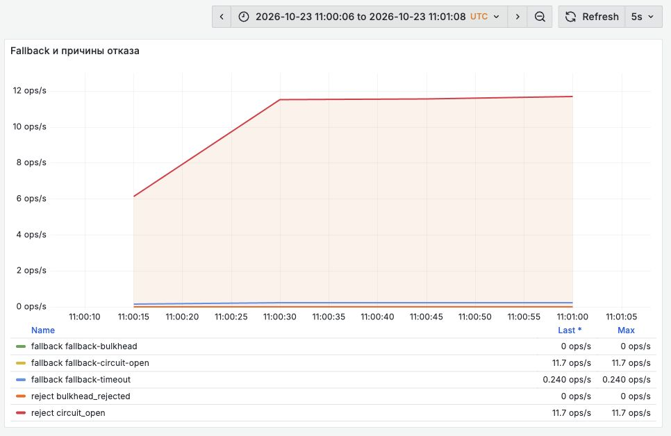

Рисунок 14. Прогон `final-slow`: преобладает `fallback-circuit-open`. Счётчики отказов и резервных ответов могут описывать разные события одного запроса, поэтому их сумма не равна числу запросов.

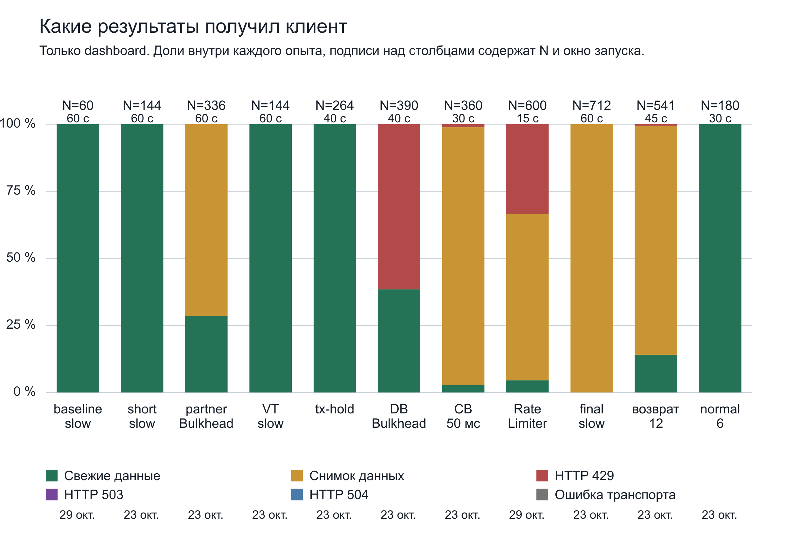

Рисунок 16. Результаты только тяжёлого маршрута. Для исходного slow используется новая серия `baseline-slow-pg`, для Rate Limiter серия `rate-limiter-clean`. Эти два столбца рассчитаны по JSONL 29 октября, остальные по опубликованным агрегатам 23 октября. Над столбцами указаны число результатов и окно запуска, по оси Y доля внутри своего опыта. Длительности и условия различаются, график показывает состав ответов. Сегменты 503, 504 и транспортных ошибок в этой выборке равны нулю. Ошибки health в `tx-hold` сюда не входят. [Данные графика](media/figure-16-data.json).

Партнёра перевели обратно на 50 мс без перезапуска приложения. В следующие 45 с получены 76 свежих ответов, 462 снимка данных и три HTTP 429. На 36 из 45 опросов Circuit Breaker оставался в `open`.

В повторе `cb-recovery-explain` 29 октября затяжное открытие не воспроизвелось. После медленного партнёра и переключения на 50 мс за 45 с получены 355 свежих ответов, 181 снимок данных и четыре HTTP 429 от DB Bulkhead. Circuit Breaker был `open` в 1 из 45 опросов и `closed` в остальных 44. Приращения счётчиков составили `successful +355`, `failed +173`, `not_permitted +8`. Одновременно счётчик локальных отказов партнёрского Bulkhead вырос на 173. Таким образом, учёт локальных ошибок автоматом подтверждён и в этой серии. Причину прежних 36 из 45 точек `open` новый опыт не устанавливает. Гипотезу о повторных открытиях именно в первом запуске оставляем непроверенной. [Исходные счётчики и временная последовательность](../evidence/cb-recovery-explain/counter-deltas-exact.json).

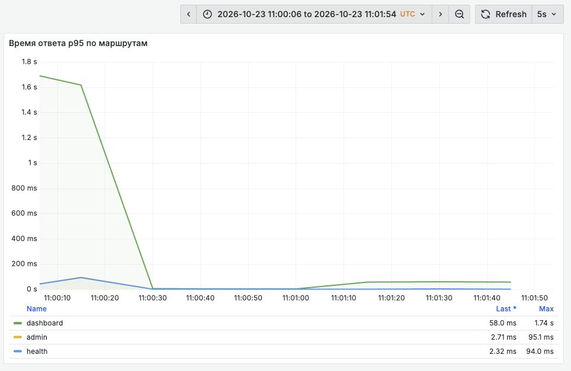

Рисунок 15. Восстановление партнёра в том же процессе. Общая задержка остаётся низкой, хотя значительная доля ответов ещё содержит снимок данных.

Дополнительный прогон `final-steady` при двенадцати тяжёлых работниках дал 57 свежих ответов и 483 снимка за 45 с после прогрева. Серверная конфигурация осталась прежней. Затем число тяжёлых работников уменьшили до шести, сохранив по одному служебному и health-работнику, интервал начала запросов 1 с и быстрого партнёра. После прогрева 20 с за 30 с измерения получены 180 свежих ответов без резервных. Клиентский p95 dashboard составил 64,2 мс, admin 3,7 мс, health 8,5 мс.

| Состояние | Число тяжёлых результатов | Свежие данные | Снимок данных | HTTP 429 |
| --- | --- | --- | --- | --- |
| Final при slow 5 с | 712 | 0 | 712 | 0 |
| Первые 45 с recovery при 12 работниках | 541 | 76 | 462 | 3 |
| Дополнительный normal при 12 работниках | 540 | 57 | 483 | 0 |
| Normal при 6 работниках после прогрева | 180 | 180 | 0 | 0 |

Последняя строка подтверждает восстановление при сниженной параллельности. Уменьшение числа работников было самостоятельным вмешательством. Этот результат нельзя приписать только возвращению партнёра к 50 мс.

Ниже сокращённые поля реальных ответов v4. Бизнес-поля убраны, значения `mode`, `outcome` и `partner.source` сохранены:

```json
{"mode":"slow-partner","outcome":"success","partner":{"source":"live"}}
{"mode":"slow-partner","outcome":"fallback-bulkhead","partner":{"source":"snapshot"}}
{"mode":"slow-partner","outcome":"fallback-timeout","partner":{"source":"snapshot"}}
{"mode":"normal","outcome":"fallback-circuit-open","partner":{"source":"snapshot"}}
```

HTTP 200 здесь подтверждает доставку согласованного ответа. Для оценки бизнес-функции дополнительно нужны доля свежих результатов, возраст снимков и время восстановления этой доли. Если начать расследование только по доле 5xx, такую деградацию можно не заметить.

При двенадцати клиентах защиты ещё влияют на свежесть результатов. Что изменится, если снять ограничение платформенных потоков Tomcat?

## 10. Виртуальные потоки и предел параллельности

Когда платформенные потоки массово заняты ожиданием, следующий опыт состоит в переводе обработки запросов на виртуальные потоки. В проекте это делает профиль `vt`:

```yaml
spring:
  threads:
    virtual:
      enabled: true
```

[application-vt.yml](https://github.com/proselytear/jug-hang-anatomy/blob/8c14914cb6b5533614cfae6e1035fe61c5a4c1de/src/main/resources/application-vt.yml#L1-L4), коммит `8c14914`.

При многих блокирующих операциях JVM может освободить несущий платформенный поток на время ожидания и использовать его для другой задачи. Большое число ожидающих операций тогда требует меньше потоков ОС. Механизм описан в [документации JDK 25](https://docs.oracle.com/en/java/javase/25/core/virtual-threads.html).

Сравнение `short-slow` и `vt-slow` выполнено на одном коммите при одинаковых параметрах запуска: двенадцать тяжёлых работников, по одному admin и health, прогрев 10 с и измерение 60 с. `TimeLimiter`, Circuit Breaker, оба Bulkhead и Rate Limiter выключены. Меняется только профиль виртуальных потоков.

Оба варианта вернули 144 свежих ответа. Клиентский p95 dashboard равен 5067,6 мс без виртуальных потоков и 5022,5 мс с ними. Основной результат этой пары: пятисекундный партнёр сохранил пятисекундную задержку. Небольшое различие квантилей короткого прогона не даёт основания объявить ускорение.

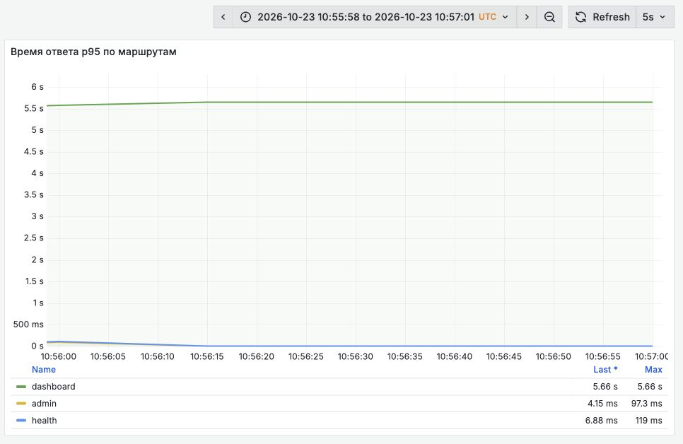

Рисунок 7. Прогон `vt-slow`. Длительность тяжёлого запроса остаётся близкой к задержке партнёра, служебные запросы отвечают быстро.

Метрики `tomcat_threads_*` для busy и max экспортировались со значением `-1`. Это недоступное измерение. Если посчитать отношение `-1/-1`, получится ложная единица насыщения. При виртуальных потоках нужны число обслуженных запросов, ожидание JDBC, количество обращений к партнёру и результаты клиентов.

Профиль обработки HTTP-запросов не меняет явно созданную фабрику `Thread.ofPlatform()` у `partnerExecutor`. С включённым `TimeLimiter` внешний HTTP по-прежнему выполняют `partner-exec-*`. При выключенном ограничителе `callable` исполняется непосредственно в потоке запроса. Поэтому вывод о конкретном участке ожидания зависит и от действующего пути выполнения.

Виртуальный поток также продолжает владеть полученным JDBC-соединением или разрешением Bulkhead до выхода из защищённого участка. Внешний API не получает от него дополнительной пропускной способности. Смысл опыта состоит в поиске следующего ограничения после снятия дефицита платформенных потоков. В нашей паре им осталось ожидание партнёра, а при более высокой параллельности ресурсы БД и партнёра по-прежнему требуют ограничения допуска.

Как сохранить доступ к диагностике, когда бизнес-запросы уже ждут эти ресурсы?

## 11. Служебный контур

Вывод этого раздела следует из кода, а не из отдельного нагрузочного опыта. Служебному запросу нужен доступ к HTTP-обработке, а для чтения состояния БД ещё и JDBC-соединение. Быстрый метод проверки может долго ждать начала исполнения, если общий пул Tomcat занят.

В `application.yml` заданы две health-группы:

```yaml
      group:
        readiness:
          include: readinessState,dbReadiness
        liveness:
          include: livenessState,ping
```

[application.yml, строки с 42 по 46](https://github.com/proselytear/jug-hang-anatomy/blob/8c14914cb6b5533614cfae6e1035fe61c5a4c1de/src/main/resources/application.yml#L42-L46), коммит `8c14914`.

`/actuator/health/liveness` не выполняет пользовательскую проверку БД. `readiness` включает `dbReadiness`. Корневой `/actuator/health`, который опрашивала основная нагрузка статьи, содержит более широкий набор компонентов, включая стандартный `db` и пользовательский `dbReadiness`. Результаты корневого health и отдельной readiness-группы нужно учитывать раздельно.

Связь liveness с общей БД может превратить один отказ зависимости в рестарт всех экземпляров приложения. Readiness задаёт политику допуска трафика: способен ли экземпляр сейчас обслужить запросы с приемлемым результатом. Если часть функций использует снимки данных и остаётся доступной, решение о выводе экземпляра из балансировки зависит от контракта этих функций.

`CachedDbReadinessHealthIndicator` хранит последний результат на время TTL и выполняет запрос БД через `budgetExecutor`. В базовом профиле TTL и бюджет проверки равны 5 с и 250 мс. После истечения бюджета вызывается отмена `Future`, а индикатор возвращает состояние недоступности. [Реализация проверки](https://github.com/proselytear/jug-hang-anatomy/blob/8c14914cb6b5533614cfae6e1035fe61c5a4c1de/src/main/java/net/proselyte/demo/hanganatomy/health/CachedDbReadinessHealthIndicator.java#L43-L81). Влияние отмены на выполняющийся JDBC зависит от его текущего этапа и драйвера.

`AdminStatusService` также использует кэш и бюджет чтения. Если обновление завершилось ошибкой, а прежняя запись есть, он возвращает её с исходом `stale_fallback`. Сервис сохраняет возможность ответить ценой устаревших служебных данных. Их возраст и допустимость нужно учитывать при использовании ответа. [AdminStatusService](https://github.com/proselytear/jug-hang-anatomy/blob/8c14914cb6b5533614cfae6e1035fe61c5a4c1de/src/main/java/net/proselyte/demo/hanganatomy/service/AdminStatusService.java#L46-L86).

В профиле `demo-latency` TTL обоих кэшей обнулён, бюджеты увеличены до 12 с, а режимы добавляют искусственные задержки. Поэтому значения базового профиля не описывают сценический запуск. Профиль и режим входят в паспорт любого сравнения.

Ни кэш, ни `budgetExecutor` не создают отдельный HTTP-коннектор или зарезервированные соединения Hikari. DB Bulkhead защищает чтение dashboard. Admin, readiness, чтение и запись снимков данных используют общий пул вне этого ограничителя. Физическая изоляция служебного контура потребовала бы отдельных ресурсов и проверки их доступности под нагрузкой.

За пределами одного экземпляра ограничения тоже складываются. Если каждый процесс может открыть `p` соединений, то `k` экземпляров потенциально создадут до `k × p`. Локальные Bulkhead и Rate Limiter также действуют отдельно в каждом процессе. Допустимую нагрузку общей зависимости приходится распределять между потребителями с учётом служебных и резервных операций. Добавление реплик при медленной БД может увеличить конкуренцию за неё.

Какие сигналы нужны, чтобы заметить эту конкуренцию до потери служебного доступа?

## 12. Метрики предупреждения и порядок действий

Нужны данные о клиентском результате и о ресурсе, который задерживает работу. Для этого стенда пригоден следующий набор PromQL:

```promql
# Только доступные Tomcat-метрики platform executor
(tomcat_threads_busy_threads{application="hang-anatomy-demo"} >= 0)
/
(tomcat_threads_config_max_threads{application="hang-anatomy-demo"} > 0)

hikaricp_connections_pending{pool="hang-hikari"}

sum by (outcome) (
  rate(hang_partner_rejections_total{
    dependency="partner-api", outcome="bulkhead_rejected"
  }[1m])
)

sum by (outcome) (
  rate(hang_partner_fallbacks_total{dependency="partner-api"}[1m])
)
```

Первое выражение исключает недоступные Tomcat-метрики. Сравнения без `bool` сохраняют значения прошедших фильтр рядов, поэтому `-1` не превращается в ложные 100 % насыщения. При нескольких экземплярах, приложениях и пулах нужно сохранить различающие метки и правильное сопоставление рядов.

В репозитории есть правила `HighEndpointLatencyP99`, `TomcatThreadSaturation`, `HikariPendingConnections`, `PartnerLatencyHigh`, `BulkheadRejecting`, `CircuitBreakerOpen` и `RateLimiterRejecting`. Их пороги демонстрационные. Подбирать их нужно под допустимую задержку, долю свежих результатов, отказы и время восстановления конкретного продукта. Рост резервных ответов способен означать успешное ограничение нагрузки и продолжающуюся недоступность свежих данных одновременно.

В коммите измерений `8c14914` `RequestLoggingInterceptor` выводит `outcome` из HTTP-статуса. Поэтому снимок данных с HTTP 200 может попасть в журнал как `success`. В сопроводительном исправлении [DashboardController](https://github.com/proselytear/jug-hang-anatomy/blob/29c24af/src/main/java/net/proselyte/demo/hanganatomy/controller/DashboardController.java#L24-L29) передаёт фактический `outcome` через атрибут запроса, а перехватчик пишет его в журнал. Источник ответа нужно сверять с `outcome` и `partner.source`, а события одного запроса связывать по его контексту. Подключение OTLP также требует проверки реальных участков трассировки: наличие приёмника само по себе не гарантирует отдельного участка SQL или внешнего HTTP.

Во время инцидента порядок действий может быть таким:

1. Зафиксировать UTC-время, коммит, профили Spring, режим зависимости и действующие параметры запуска.
2. Сохранить клиентские задержки, статусы и источники данных. Отдельно проверить admin, liveness, readiness и метрики.
3. До перезапуска снять несколько дампов потоков и состояние PostgreSQL с теми же временными отметками.
4. Сопоставить занятость Tomcat, Hikari active/pending и выполняющиеся обращения к партнёру. Проверить пропуски опроса метрик.
5. По стекам определить, что удерживает ресурс: сеть, получение JDBC, SQL, блокировка, вычисления или искусственная задержка.
6. Ограничить поступление новой работы доступным механизмом и проверить контракт отказа. Увеличивать пул только после оценки нагрузки на зависимость.
7. Проверить резервный и служебный пути: какие общие ресурсы они используют и какой результат возвращают при перегрузке.
8. После стабилизации воспроизвести причину, меняя одно условие за раз. Считать отдельно свежие ответы, резервные данные, отказы и транспортные ошибки.
9. Проверить возвращение к нормальной работе при прежней нагрузке. Если помогло снижение параллельности, зафиксировать его как отдельное изменение условий.

Расследование закончено, когда клиент получает согласованный результат, а занятый ресурс освобождается в проверенной границе времени. Какие три вопроса помогут сохранить эту связь в рабочей системе?

## 13. Три вопроса к рабочей системе

В блокирующем сервисе свободный CPU совместим с полной остановкой полезной работы. Запросы занимают потоки и соединения, пока ждут друг друга. Расширение пула иногда отодвигает предел, но вместе с ним может вырасти нагрузка на общую зависимость. Перед изменением размера пула нужно понять, кто владеет его ресурсом и почему так долго.

На стенде короткая транзакция вернула JDBC-соединения до внешнего HTTP. Bulkhead сохранил часть ресурсов ценой резервных ответов. TimeLimiter сократил ожидание клиента, сохранив работу после его ответа. Circuit Breaker учитывал локальные ошибки допуска, а HTTP 200 скрывал отсутствие свежих данных. Виртуальные потоки изменили способ ожидания, сохранив ограничения БД и партнёра.

При разборе своего приложения начните с трёх вопросов. **Какой ресурс удерживает запрос? Как долго ему разрешено его удерживать? Что получит новая работа, когда лимит исчерпан?** Ответы должны быть видны и в коде, и в условиях перегрузки: когда возвращается соединение, заканчивается сетевой вызов, освобождается разрешение и какой результат получает клиент.

В [записи доклада JPoint «Анатомия зависания»](https://youtu.be/QJKoIuWu8JA) порядок другой: на сцене сначала возвращаем доступ к служебным запросам, затем разбираем внутренние причины. Посмотрите, как тот же инцидент развивается вживую. Для самостоятельных опытов доступны [репозиторий стенда](https://github.com/proselytear/jug-hang-anatomy) и процедура ниже.

## 14. Приложение с процедурой воспроизведения

Для штатного демонстрационного запуска нужны Git, Docker с Compose, make, curl и rg. Команды запускают JMeter из репозитория. Его результаты относятся к сценическому сценарию. Клиентские числа статьи получены отдельным последовательным генератором запросов на Python.

```bash
git clone https://github.com/proselytear/jug-hang-anatomy.git
cd jug-hang-anatomy
make up
make partner-slow
make test-mixed-load
make dashboard-urls
```

Для исходного состояния клонируйте репозиторий в другой каталог и выберите `demo/00-baseline`. Текущий рабочий каталог для переключения версий не используйте. Самостоятельное повторение таблиц требует закреплённых коммитов и условий каждого опыта, а не последней версии ветки.

`make up` включает профили `docker,demo-latency`. В измерениях чистого замедления внешнего API используется только `docker`. Основные различия настроек коммита `8c14914` показаны ниже.

| Настройка | Базовый application.yml | Профиль demo-latency | Чистое сравнение baseline и short |
| --- | --- | --- | --- |
| Tomcat max threads | 32 | 16 | 16 |
| Hikari maximum pool size | 10 | 6 | 6 |
| Ожидание соединения | 750 мс | 12 с | 12 с |
| HTTP read timeout | 1,8 с | 15 с | 15 с |
| Overall deadline | 2 с | 15 с | 15 с |
| TimeLimiter при включении | 1,5 с | 12 с | выключен |
| Partner Bulkhead | 8 разрешений | 8 разрешений | выключен |
| Кэш admin и readiness main | 5 с | 0 с | 5 с в short |
| Бюджет admin и readiness main | 250 мс | 12 с | 250 мс в short |

В `demo-latency` режим `slow-partner` добавляет 1500 мс ожидания внутри транзакции и по 2000 мс в admin/readiness. В чистом сравнении эти задержки выключены. Время ожидания соединения, сетевой тайм-аут и общий бюджет задаются отдельно от задержки WireMock. Поэтому результат штатного `make partner-slow` и результат чистого HTTP-опыта описывают разные условия.

Полная процедура, генератор, изоляция портов, команды `jcmd` и запросы PostgreSQL вынесены в [docs/article-reproduction.md](../docs/article-reproduction.md). У каждого нового прогона есть каталог `evidence/<имя>/` с `passport.json`, клиентскими `requests.jsonl`, исходными опросами метрик и дополнительными диагностическими файлами. Перцентили считаются по запросам, начавшимся в измерительном окне, с линейной интерполяцией. После окончания запуска генератор дожидается уже отправленных запросов. Для достигнутой пропускной способности учитывается этот завершающий интервал.

Измерения 23 октября сохранены по опубликованной версии статьи и её иллюстрациям. Первичные JSONL и полные дампы той серии в доступном архиве не сохранились. Их не заменяли восстановленными записями. В `evidence/v4-published/` находятся исходный DOCX, опубликованные агрегаты и указание происхождения. Прогоны 29 октября имеют новые имена, исходные файлы и собственные результаты. Общий график явно различает эти два вида источников.

В исторических коммитах `4575427` и `8c14914` воспроизведён сбой запуска Hikari: при привязке свойств Spring вызывает `getConnection()`, пул запускается до установки `pool-name` и отклоняет последующее изменение имени. Для их запуска подготовительный скрипт меняет только внешнюю копию конфигурации. В сопроводительном исправлении имя задано через `spring.datasource.name`, поэтому новая версия запускается со штатными YAML. Подробности и доказательство причины приведены в процедуре воспроизведения.

## 15. Первичные источники

- [Описание доклада JPoint](https://jpoint.ru/talks/20010040/).
- [Apache Tomcat 11 HTTP Connector](https://tomcat.apache.org/tomcat-11.0-doc/config/http.html).
- [HikariCP и параметры ожидания соединения](https://github.com/brettwooldridge/HikariCP#gear-configuration-knobs-baby).
- [Spring Boot 4.0 Actuator и проверки здоровья](https://docs.spring.io/spring-boot/4.0/reference/actuator/endpoints.html).
- [JDK 25 и виртуальные потоки](https://docs.oracle.com/en/java/javase/25/core/virtual-threads.html).
- [JDK 25 и jcmd](https://docs.oracle.com/en/java/javase/25/docs/specs/man/jcmd.html).
- [JDK 25 и CompletableFuture.cancel](https://docs.oracle.com/en/java/javase/25/docs/api/java.base/java/util/concurrent/CompletableFuture.html#cancel(boolean)).
- [Resilience4j 2.4.0 и Bulkhead](https://github.com/resilience4j/resilience4j/blob/v2.4.0/resilience4j-bulkhead/src/main/java/io/github/resilience4j/bulkhead/Bulkhead.java).
- [Resilience4j 2.4.0 и TimeLimiterImpl](https://github.com/resilience4j/resilience4j/blob/v2.4.0/resilience4j-timelimiter/src/main/java/io/github/resilience4j/timelimiter/internal/TimeLimiterImpl.java).
- [Resilience4j 2.4.0 и CircuitBreakerConfig](https://github.com/resilience4j/resilience4j/blob/v2.4.0/resilience4j-circuitbreaker/src/main/java/io/github/resilience4j/circuitbreaker/CircuitBreakerConfig.java).
- [Resilience4j 2.4.0 и AtomicRateLimiter](https://github.com/resilience4j/resilience4j/blob/v2.4.0/resilience4j-ratelimiter/src/main/java/io/github/resilience4j/ratelimiter/internal/AtomicRateLimiter.java).
- [Параметры PostgreSQL JDBC](https://jdbc.postgresql.org/documentation/use/).
- [Prometheus и histogram_quantile](https://prometheus.io/docs/prometheus/latest/querying/functions/#histogram_quantile).
